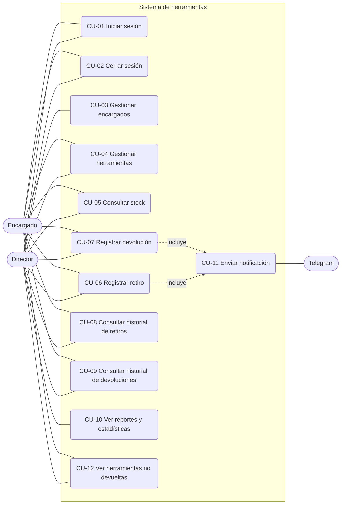

# Casos de uso — Sistema de herramientas E.E.S.T. Nº 1

## 1. Actores

| Actor | Descripción |
|---|---|
| **Director** | Autoridad de la escuela. Administra encargados, ve reportes y recibe las notificaciones. Puede hacer todo lo que hace el encargado. |
| **Encargado de herramientas** | Persona del pañol. Registra retiros y devoluciones y mantiene el inventario. |
| **Telegram (sistema externo)** | Servicio externo que entrega los avisos al teléfono del director. |

Alumnos y profesores **no usan el sistema**: son datos que el encargado registra al entregar una herramienta.

## 2. Diagrama de casos de uso

**Permisos por rol**

| Caso de uso | Director | Encargado |
|---|:---:|:---:|
| CU-01 / CU-02 Iniciar y cerrar sesión | ✔ | ✔ |
| CU-03 Gestionar encargados | ✔ | ✘ |
| CU-04 Gestionar herramientas (alta y edición) | ✔ | ✔ |
| CU-04 Eliminar herramientas | ✔ | ✘ |
| CU-05 Consultar stock | ✔ | ✔ |
| CU-06 / CU-07 Retiros y devoluciones | ✔ | ✔ |
| CU-08 / CU-09 Historiales | ✔ | ✔ |
| CU-10 Reportes y estadísticas | ✔ | ✘ |
| CU-12 Herramientas no devueltas | ✔ | ✔ |

## 3. Especificación de los casos de uso principales

### CU-01 Iniciar sesión
- **Actores:** Director, Encargado.
- **Precondición:** el usuario existe y está activo.
- **Flujo principal:** 1) Ingresa usuario y contraseña. 2) El sistema valida los datos. 3) Compara la contraseña con el hash guardado. 4) Crea la sesión y muestra el inicio según el rol.
- **Flujos alternativos:** campos vacíos → mensaje de error; usuario o contraseña incorrectos → mensaje genérico (no dice cuál falló); usuario inactivo → no puede ingresar.
- **Postcondición:** sesión iniciada con su rol.

### CU-03 Gestionar encargados
- **Actor:** Director.
- **Flujo principal:** 1) Abre "Usuarios". 2) Elige alta, edición o baja. 3) Completa nombre, usuario, contraseña, turno y horario. 4) El sistema valida y guarda (la contraseña se guarda con hash).
- **Alternativos:** el usuario ya existe → error; contraseña de menos de 8 caracteres → error; la "baja" desactiva la cuenta (no la borra, para conservar el historial).

### CU-04 Gestionar herramientas
- **Actores:** Director, Encargado (solo el Director elimina).
- **Flujo principal:** 1) Abre "Herramientas". 2) Elige nueva, editar o eliminar. 3) Completa nombre, categoría y cantidad total. 4) El sistema valida y guarda.
- **Alternativos:** no se puede bajar la cantidad total por debajo de las unidades prestadas; no se puede eliminar una herramienta con historial de préstamos.

### CU-06 Registrar retiro
- **Actores:** Encargado, Director.
- **Precondición:** sesión iniciada; la herramienta tiene stock disponible.
- **Flujo principal:** 1) Elige la herramienta y la cantidad. 2) Ingresa nombre y apellido de quien retira, si es alumno o profesor y, si es alumno, el curso. 3) El sistema valida. 4) Registra el préstamo con fecha y hora, y **descuenta el stock** (en una transacción). 5) Dispara CU-11 (notificación).
- **Alternativos:** cantidad mayor al stock disponible → error; curso vacío cuando es alumno → error; si falla Telegram, el retiro **igual se guarda** y la notificación queda como "pendiente".
- **Postcondición:** préstamo abierto y stock disminuido.

### CU-07 Registrar devolución
- **Actores:** Encargado, Director.
- **Precondición:** existe un préstamo abierto.
- **Flujo principal:** 1) Busca el préstamo abierto (por persona o herramienta). 2) Confirma la devolución. 3) El sistema completa la fecha de devolución y el encargado que la recibió, y **aumenta el stock**. 4) Dispara CU-11.
- **Alternativos:** el préstamo ya estaba devuelto → error; falla Telegram → se guarda igual.

### CU-08 / CU-09 Consultar historiales
- **Flujo principal:** 1) Abre el historial. 2) Filtra por herramienta, persona, curso o rango de fechas. 3) El sistema muestra la lista (sin filtros, se ven los últimos registros).
- **Alternativo:** sin resultados → mensaje "No hay registros".

### CU-10 Ver reportes y estadísticas
- **Actor:** Director.
- **Flujo principal:** 1) Abre "Reportes". 2) Elige un período. 3) El sistema muestra gráficos: herramientas más solicitadas, retiros por curso y por mes, y herramientas con stock bajo.
- **Fin:** ayuda a decidir qué herramientas comprar.

### CU-11 Enviar notificación
- **Actor secundario:** Telegram.
- **Flujo principal:** 1) El sistema arma el mensaje ("La herramienta X fue retirada/devuelta por Y"). 2) Lo envía al chat del director mediante la API del bot. 3) Registra el resultado.
- **Alternativos:** la API no responde (timeout) o devuelve error → se registra como "fallida" y se reintenta; el usuario no ve interrumpido su trabajo.

### CU-12 Ver herramientas no devueltas
- **Flujo principal:** el sistema lista los préstamos abiertos con más de X horas (configurable). Si hay alguno, envía un aviso al director por CU-11.
