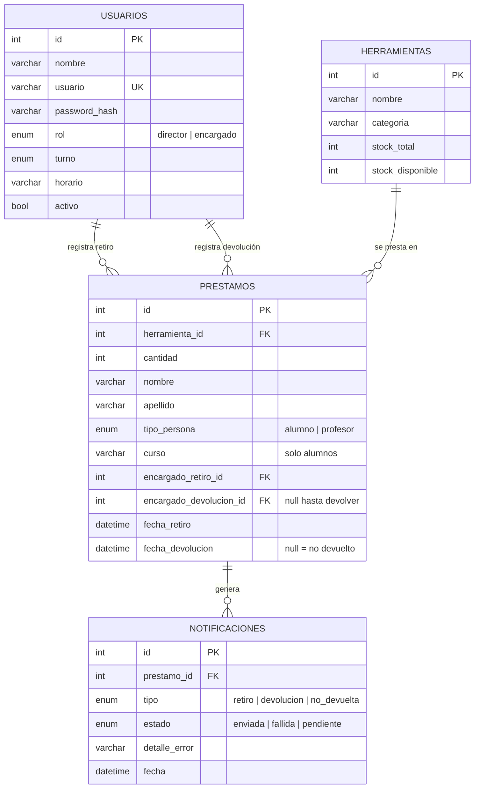

# Modelo de datos

Base de datos relacional **MySQL**. Se eligió relacional porque los datos tienen relaciones claras (una herramienta tiene muchos préstamos; un encargado registra muchos préstamos) y el stock requiere **transacciones** para no quedar inconsistente.

## 1. Diagrama entidad-relación

## 2. Descripción de las tablas

**usuarios** — Cuentas del sistema. `usuario` es único. La contraseña se guarda **hasheada** (`password_hash` de PHP), nunca en texto plano. `activo` permite dar de baja sin perder el historial.

**herramientas** — Inventario. `stock_total` es todo lo que la escuela posee; `stock_disponible` lo que está en el pañol. Las unidades prestadas son `stock_total - stock_disponible`.

**prestamos** — Un registro por retiro. Si `fecha_devolucion` es NULL, la herramienta sigue prestada. De esta única tabla salen el historial de retiros, el de devoluciones y las estadísticas. Esta es la decisión central del diseño: **evita duplicar datos** entre "retiros" y "devoluciones".

**notificaciones** *(se agrega en la V3)* — Registro de cada aviso enviado por Telegram, con su resultado. Permite reintentar los fallidos y demostrar el manejo de errores de la API.

## 3. Reglas de integridad

- `stock_disponible` nunca es menor que 0 ni mayor que `stock_total`.
- Un retiro y su descuento de stock se hacen en **una transacción**: o se guardan los dos o ninguno.
- No se elimina una herramienta ni un usuario con préstamos asociados (clave foránea).
- Si `tipo_persona = 'alumno'`, el campo `curso` es obligatorio (se valida en el servidor).

## 4. Normalización

- **1FN:** todos los campos son atómicos (nombre y apellido separados, sin listas en una celda).
- **2FN:** todas las tablas tienen clave primaria simple (`id`), por lo que no hay dependencias parciales.
- **3FN:** los datos de la herramienta están solo en `herramientas` y los del encargado solo en `usuarios`; `prestamos` los referencia por clave foránea y no los repite.

**Decisión consciente:** nombre, apellido y curso de quien retira están en `prestamos` y no en una tabla `personas`. La escuela no tiene (ni se pide) un padrón de alumnos y los datos se ingresan al momento del retiro. Si más adelante se quisiera, se puede extraer una tabla `personas`.

## 5. Claves

| Tabla | Clave primaria | Claves foráneas | Únicas |
|---|---|---|---|
| usuarios | id | — | usuario |
| herramientas | id | — | — |
| prestamos | id | herramienta_id, encargado_retiro_id, encargado_devolucion_id | — |
| notificaciones | id | prestamo_id | — |

El script `database/schema.sql` del repositorio crea las primeras tres tablas.
